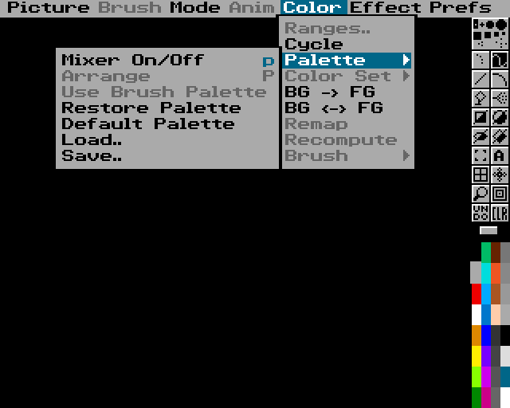
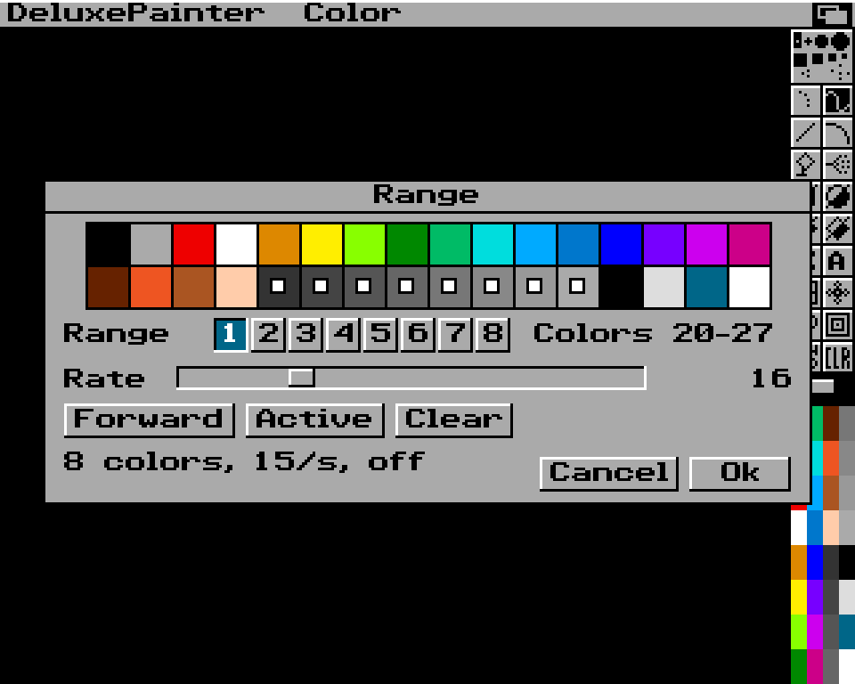
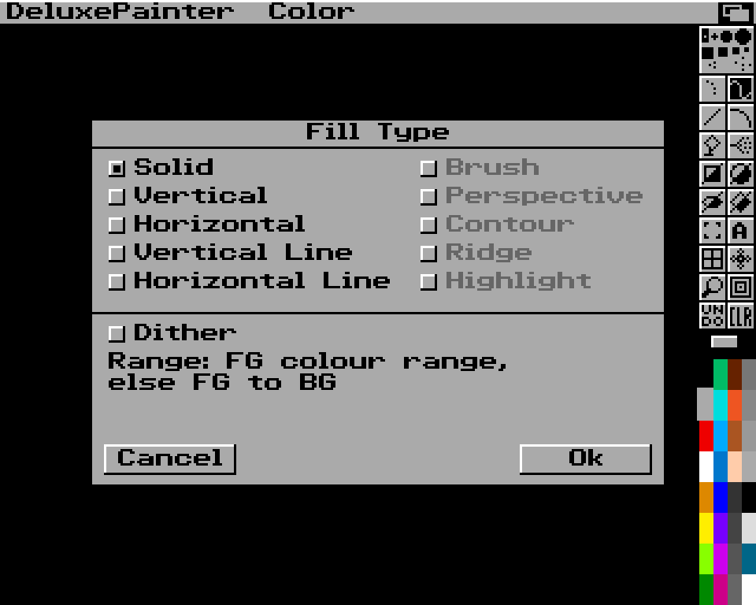

<p align="center">
  
</p>

<h1 align="center">DeluxePainter</h1>

<p align="center">
  A pixel-art editor in the spirit of the classic Amiga paint programs —<br>
  real OCS/AGA hardware rules, IFF ILBM/ANIM files, layers, and an MCP interface for AI agents.<br>
  Native Rust · macOS · Windows · Linux
</p>

---

> **Status: pre-alpha (Phase 1 first paint, Phase 2 files started).** The window shows a classic Amiga LoRes paint screen (title bar, toolbox, palette, pull-down menus) rendered pixel-exactly; freehand painting, tool/brush/colour selection, undo/redo, CLR, paint-mode selection and a few menu commands work. IFF ILBM and indexed PNG pictures can be inspected, converted and opened from the command line. Everything else is still to come.

<p align="center">
  
  
</p>

## What it will be

- **The classic look and feel**, rebuilt from scratch: menu bar, two-column toolbox, palette, requesters — rendered as crisp pixel art at integer scales (1×–5×, 4K-ready), never blurred.
- **Real Amiga targets**: OCS and AGA profiles (PAL/NTSC, LoRes/HiRes/SuperHiRes, interlace, EHB, HAM6, HAM8) are enforced document rules, not a visual filter.
- **Amiga files done right**: IFF ILBM import/export (ByteRun1, masks, CAMG, colour cycling) and IFF ANIM; PNG import/export; JPEG import.
- **Modern project editing**: the native `.dpxproj` format keeps layers, groups, frames, palettes and editor state. Saving is lossless; Amiga files are produced by an explicit, checked export.
- **Classic tools**: freehand, lines, curves, shapes, fills with gradients and dithering, airbrush, brushes with transform, stencil, symmetry, grid, magnify, spare page, colour cycling, animation with light table.
- **MCP server**: Claude and other MCP clients can create, draw, inspect and export documents through typed commands — the same command engine the GUI uses, no mouse automation.

See [`docs/FEATURES.md`](docs/FEATURES.md) for the prioritised feature set and [`docs/ROADMAP.md`](docs/ROADMAP.md) for the plan.

## Documentation

| Document | Content |
|---|---|
| [FEATURES.md](docs/FEATURES.md) | Condensed, prioritised feature list (MVP → later) |
| [ROADMAP.md](docs/ROADMAP.md) | Phases and milestones |
| [ARCHITECTURE.md](docs/ARCHITECTURE.md) | Crates, document model, command engine, rendering, MCP |
| [adr/](docs/adr/) | Architecture decision records |
| [HARDWARE_MODES.md](docs/HARDWARE_MODES.md) | OCS/AGA display modes, palettes, EHB/HAM rules |
| [IFF_SUPPORT_MATRIX.md](docs/IFF_SUPPORT_MATRIX.md) | ILBM/ANIM chunk layouts and support plan |
| [research/](docs/research/) | Manual, video and dependency research with sources |
| [design/](docs/design/) | UI layout mockups |

## Building

Requires [rustup](https://rustup.rs); the toolchain version is pinned in `rust-toolchain.toml`. A non-rustup Rust (for example Homebrew's `rust` formula) ignores that file; if `which cargo` does not point to `~/.cargo/bin/cargo`, put `~/.cargo/bin` first in `PATH` or remove the other Rust.

```bash
cargo run -p deluxepainter --release
```

Headless snapshot of the start screen (used for visual comparison tests):

```bash
cargo run -p deluxepainter -- --snapshot screen.png --scale 2
```

Controls so far: left mouse = FG colour, right mouse = BG colour; click toolbox buttons, brushes and palette cells. Every toolbox drawing tool works (ADR-14): freehand (dotted, continuous, filled), line and curve (drag, release, move to bend, click), rectangle/circle/ellipse/polygon as outline (upper-left half of the button) or filled (lower-right half), fill, airbrush and text; Shift makes lines horizontal/vertical and rectangles square; a polygon closes when you click its first corner or press Space/Return; Grid (`g`), Symmetry (`/`) and Magnify (`m`, split screen, Zoom with `>` `<`) are toggles. Tool keys as in DeluxePaint: `s`, `d`/`D`, `v`, `q`, `f`, `r`/`R`, `c`/`C`, `e`/`E`, `t`, `K`. Hold the right mouse button on the title bar for the menus (release on an item to select it, click the left button to select several Prefs at once); `F1`–`F8` paint modes; `U` or UNDO undo, `Shift+U` or right-click on UNDO redo (64 steps); `F10` hide/show toolbox and title bar, `F9` title bar only. The window snaps to the picture's screen in whole and half steps when you resize it; Prefs ▸ Pixel Size (or Cmd/Ctrl + `+`, `−`, `0` for half a step bigger, smaller, largest) sets the step; Ctrl+Cmd+F (macOS) or F11 switches full screen.

Pictures: IFF ILBM and indexed PNG in and out; true-colour PNG and JPEG in (HAM/EHB come later). True-colour pictures get a new palette with the mode's colour count and Floyd–Steinberg dithering; pictures bigger than any screen are scaled to the current screen; transparent pixels become pink colour 0 (ADR-9). `info` shows how a picture will open:

```bash
cargo run -p deluxepainter --release -- info picture.iff
```

```bash
cargo run -p deluxepainter --release -- convert picture.iff picture.png
```

```bash
cargo run -p deluxepainter --release -- --open picture.iff
```

Picture ▸ Load.. and Save.. open a DeluxePaint-style file requester (click a `<DIR>` to open it, click a file to choose it, double-click to load/save; Drawer, Pattern with AmigaDOS wildcards such as `#?.iff`, Disks, Assigns, Parent). Save writes IFF ILBM with the display mode (CAMG), pixel aspect and colour cycling ranges; a name ending in `.png` writes PNG. Whatever a load or save could not keep (unknown chunks, mask plane, what PNG cannot store) or had to change (scaled, colours reduced, page enlarged) is listed in a requester with Ok afterwards.

Pages larger than the screen: Picture ▸ Page Size.. (Standard, Full Page, Overscan or any size up to 1008×1024); arrow keys scroll (Alt+arrows by a screen), `n` centres the spot under the pointer, the mouse wheel or trackpad scrolls too; Picture ▸ Show Page (Shift+S) shows the whole page — drag the rectangle and release to jump there.

Display modes: Picture ▸ Screen Format.. chooses PAL/NTSC LoRes, HiRes and SuperHiRes (laced or not), the screen size (Standard, Overscan or a Custom width/height), palette size, page size and whether to keep the picture.

Menus that work (everything else is ghosted until it exists, ADR-15): Picture ▸ Load.., Save.., Delete.. (asks Yes/No), Flip, Spare (Swap `j`, Copy to Spare Ctrl+`j`, Merge in Front/Back with colour 0 transparent, Delete This Page — each page keeps its own undo), Page Size.., Show Page, Screen Format.., About.. (`?`), Quit; Color ▸ Cycle (Tab: cycles the colour ranges loaded with the picture on screen only), Palette ▸ Restore / Default / Load.. / Save.. (DeluxePaint palette files: ILBM with BMHD + CMAP + CRNG, no BODY; Load also takes the colours of any ILBM picture), BG -> FG, BG <-> FG; Effect ▸ Background ▸ Fix / Free (CLR and `k` then go back to the fixed picture); Mode, Prefs and Pixel Size.

<p align="center">
  
</p>

Color ▸ Ranges.. opens the Range requester (ADR-22): pick one of eight ranges, click its first and last colour (or drag across the palette), set its speed, direction and Active; a new picture starts with two inactive default ranges. Ok keeps the ranges (saved as CRNG chunks), Cancel drops the edits.

<p align="center">
  
</p>

Toolbox settings (ADR-20): right-click Grid, Symmetry or Fill, or the freehand, line, curve, outline-shape and Airbrush buttons, to open the Gridding, Symmetry, Fill Type or Spacing requester (Return = Ok, Esc = Cancel, Tab = next field; `F` and `V` open Fill Type and Spacing). Fill can paint gradients through the colour range of the foreground colour, Spacing lays brush stamps along lines and outlines (N total, every Nth pixel, airbrushed), Symmetry can mirror, and Effect ▸ Stencil ▸ Make.. protects colours.

<p align="center">
  
</p>

Snapshot options: `--palette gold16`, `--fg N`, `--tool NAME[:filled]`, `--menu M[:I[:S]]` (open menu M, highlight item I and sub item S), `--open picture.iff` (also PNG/JPEG), `--requester` (Screen Format requester), `--file-requester load|save` with `--drawer DIR`, `--file NAME`, `--drawer-as TEXT` (Load/Save requester), `--page WxH`, `--scroll X,Y`, `--commands FILE.json` (run a JSON array of commands first, e.g. `docs/design/screenshots/phase3-tools.json`), `--show-page`, `--page-size-requester`, `--fill-requester`, `--grid-requester`, `--symmetry-requester`, `--spacing-requester`, `--stencil-requester [--protect 1,2,3]`, `--palette-requester`, `--range-requester`, `--notes` (the notes of `--open`), `--font-preview out.png`.

## MCP server (spike)

`deluxepainter mcp` runs a headless [MCP](https://modelcontextprotocol.io) server on stdin/stdout (rmcp; stdout carries protocol messages only, logs go to stderr). It is off unless a client starts it. Tools: `app_status`, `new_document`, `get_document_state` (ADR-21), `execute_command` (any engine command as JSON, with `expected_revision` and `dry_run`), `undo`, `redo`, `get_palette`, `get_pixels`, `render_png` (the page as an image, so an agent can look at its work), `open_picture` and `save_picture` (ADR-24). The file tools work only inside directories you approve with `--allow-dir DIR` (repeatable); without it they fail with `FILE_ACCESS_OFF`. They read and write indexed IFF ILBM and indexed PNG; true-colour PNG and JPEG are not opened over MCP. Example client configuration:

```json
{
  "mcpServers": {
    "deluxepainter": {
      "command": "/path/to/deluxepainter",
      "args": ["mcp", "--allow-dir", "/path/to/pictures"]
    }
  }
}
```

## Project files (.dpxproj)

The lossless project format is a ZIP with a JSON manifest and one indexed PNG per layer; see [`docs/PROJECT_FORMAT.md`](docs/PROJECT_FORMAT.md). On the command line, `deluxepainter info x.dpxproj` describes a project and `deluxepainter convert a.iff b.dpxproj` (and back) converts. Wiring it into the Save and Export menus is still to do.

Paint modes and the Brush menu (ADR-19): `dpx_core::paint::plot` implements Smear, Shade, Blend, Cycle, Smooth, Mix and HBrite. The Brush menu flips, rotates by 90 degrees, doubles/halves, outlines/trims and recolours the custom brush, moves its handle, and loads/saves brush files (IFF ILBM). Items that need a drag (Stretch, Any Angle, Shear, Bend, Place) stay ghosted. `DPX_MODES_PNG=out.png cargo test -p deluxepainter mode_demo` renders the mode demo `docs/design/screenshots/phase3-modes.png`.

## License

Copyright © 2026 Dominik Schmidt. DeluxePainter is source-available under the [PolyForm Noncommercial License 1.0.0](LICENSE.md). You may use, modify and share it for any **noncommercial** purpose. Commercial use requires a separate license from the author.

## Disclaimer

DeluxePainter is an independent project. It is not affiliated with, endorsed by, or connected to Electronic Arts. "Deluxe Paint" / "DeluxePaint" is a trademark of Electronic Arts Inc.; Amiga is a trademark of its respective owner. No original program code, artwork, fonts or documentation of DeluxePaint are included in this repository.
