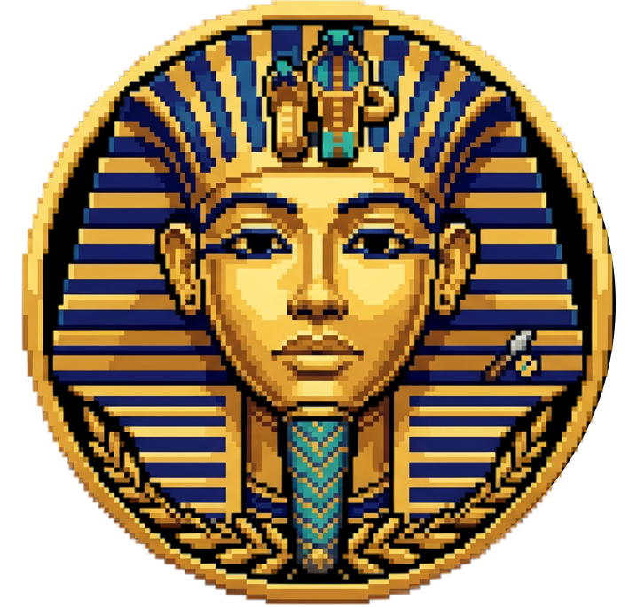
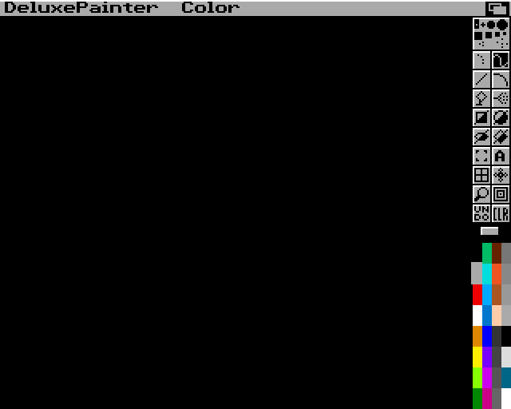
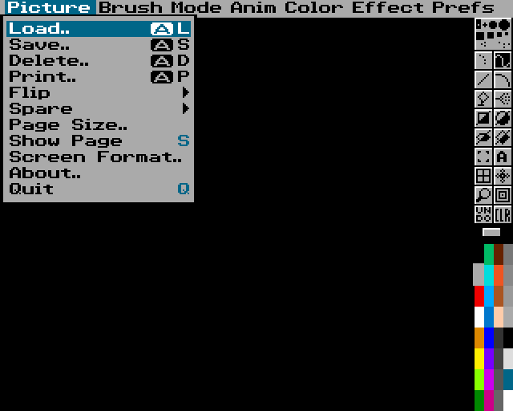

<p align="center">
  
</p>

<h1 align="center">DeluxePainter</h1>

<p align="center">
  A pixel-art editor in the spirit of the classic Amiga paint programs —<br>
  real OCS/AGA hardware rules, IFF ILBM/ANIM files, layers, and an MCP interface for AI agents.<br>
  Native Rust · macOS · Windows · Linux
</p>

---

> **Status: pre-alpha (Phase 1 first paint, Phase 2 files started).** The window shows a classic Amiga LoRes paint screen (title bar, toolbox, palette, pull-down menus) rendered pixel-exactly; freehand painting, tool/brush/colour selection, undo/redo, CLR, paint-mode selection and a few menu commands work. IFF ILBM and indexed PNG pictures can be inspected, converted and opened from the command line. Everything else is still to come.

<p align="center">
  
  
</p>

## What it will be

- **The classic look and feel**, rebuilt from scratch: menu bar, two-column toolbox, palette, requesters — rendered as crisp pixel art at integer scales (1×–5×, 4K-ready), never blurred.
- **Real Amiga targets**: OCS and AGA profiles (PAL/NTSC, LoRes/HiRes/SuperHiRes, interlace, EHB, HAM6, HAM8) are enforced document rules, not a visual filter.
- **Amiga files done right**: IFF ILBM import/export (ByteRun1, masks, CAMG, colour cycling) and IFF ANIM; PNG import/export; JPEG import.
- **Modern project editing**: the native `.dpxproj` format keeps layers, groups, frames, palettes and editor state. Saving is lossless; Amiga files are produced by an explicit, checked export.
- **Classic tools**: freehand, lines, curves, shapes, fills with gradients and dithering, airbrush, brushes with transform, stencil, symmetry, grid, magnify, spare page, colour cycling, animation with light table.
- **MCP server**: Claude and other MCP clients can create, draw, inspect and export documents through typed commands — the same command engine the GUI uses, no mouse automation.

See [`docs/FEATURES.md`](docs/FEATURES.md) for the prioritised feature set and [`docs/ROADMAP.md`](docs/ROADMAP.md) for the plan.

## Documentation

| Document | Content |
|---|---|
| [FEATURES.md](docs/FEATURES.md) | Condensed, prioritised feature list (MVP → later) |
| [ROADMAP.md](docs/ROADMAP.md) | Phases and milestones |
| [ARCHITECTURE.md](docs/ARCHITECTURE.md) | Crates, document model, command engine, rendering, MCP |
| [adr/](docs/adr/) | Architecture decision records |
| [HARDWARE_MODES.md](docs/HARDWARE_MODES.md) | OCS/AGA display modes, palettes, EHB/HAM rules |
| [IFF_SUPPORT_MATRIX.md](docs/IFF_SUPPORT_MATRIX.md) | ILBM/ANIM chunk layouts and support plan |
| [research/](docs/research/) | Manual, video and dependency research with sources |
| [design/](docs/design/) | UI layout mockups |

## Building

Requires [rustup](https://rustup.rs); the toolchain version is pinned in `rust-toolchain.toml`. A non-rustup Rust (for example Homebrew's `rust` formula) ignores that file; if `which cargo` does not point to `~/.cargo/bin/cargo`, put `~/.cargo/bin` first in `PATH` or remove the other Rust.

```bash
cargo run -p deluxepainter --release
```

Headless snapshot of the start screen (used for visual comparison tests):

```bash
cargo run -p deluxepainter -- --snapshot screen.png --scale 2
```

Controls so far: left mouse = FG colour, right mouse = BG colour; click toolbox buttons, brushes and palette cells; hold the right mouse button on the title bar for the menus (release on an item to select it, click the left button to select several Prefs at once); `F1`–`F8` paint modes; `U` or UNDO undo, `Shift+U` or right-click on UNDO redo (64 steps); `F10` hide/show toolbox and title bar, `F9` title bar only.

Pictures (IFF ILBM and indexed PNG; HAM/EHB and true-colour import come later):

```bash
cargo run -p deluxepainter --release -- info picture.iff
```

```bash
cargo run -p deluxepainter --release -- convert picture.iff picture.png
```

```bash
cargo run -p deluxepainter --release -- --open picture.iff
```

Snapshot options: `--palette gold16`, `--fg N`, `--tool NAME[:filled]`, `--menu M[:I[:S]]` (open menu M, highlight item I and sub item S), `--open picture.iff`, `--font-preview out.png`.

## License

Copyright © 2026 Dominik Schmidt. DeluxePainter is source-available under the [PolyForm Noncommercial License 1.0.0](LICENSE.md). You may use, modify and share it for any **noncommercial** purpose. Commercial use requires a separate license from the author.

## Disclaimer

DeluxePainter is an independent project. It is not affiliated with, endorsed by, or connected to Electronic Arts. "Deluxe Paint" / "DeluxePaint" is a trademark of Electronic Arts Inc.; Amiga is a trademark of its respective owner. No original program code, artwork, fonts or documentation of DeluxePaint are included in this repository.
