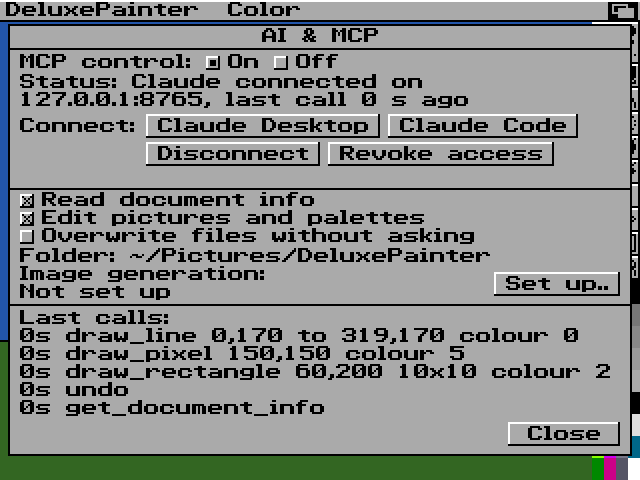
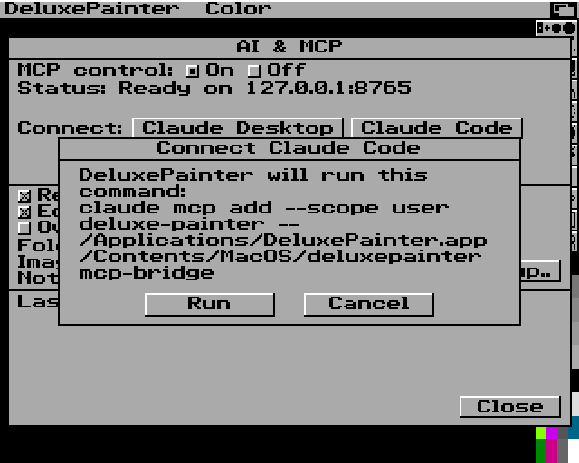
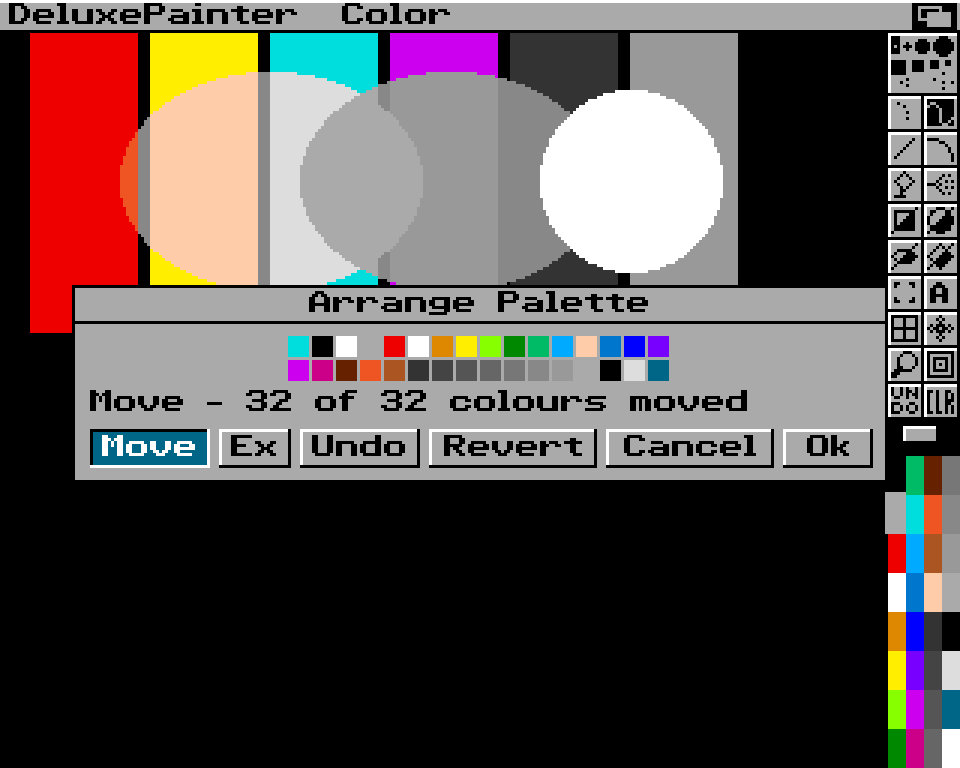
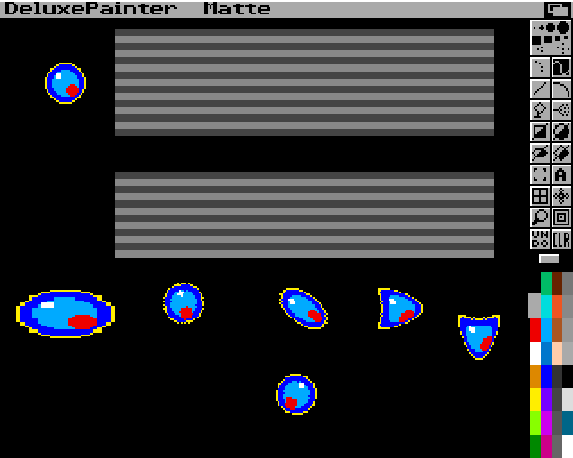
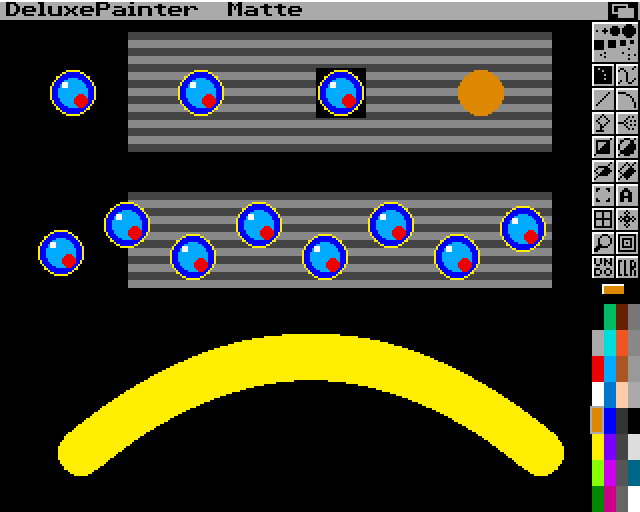
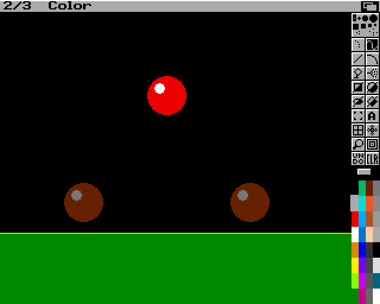
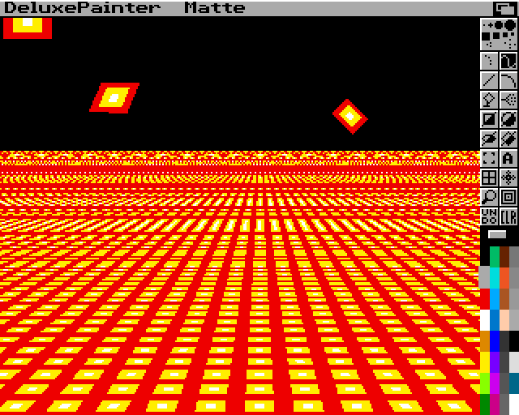
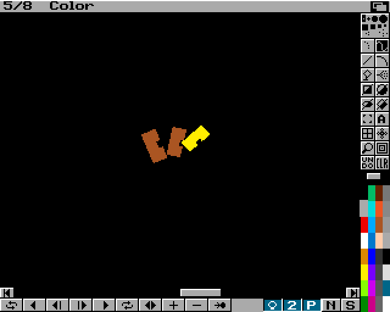
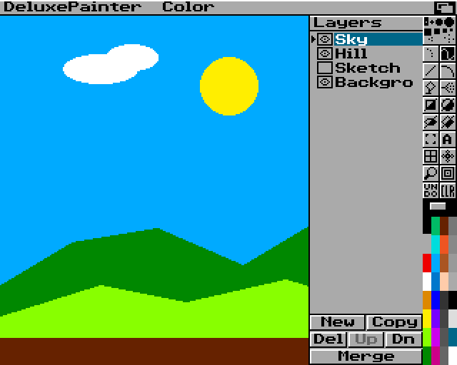
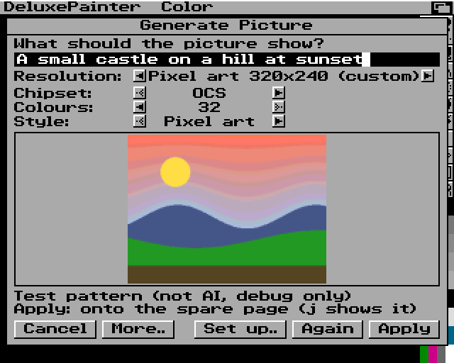

<p align="center">
  
</p>

<h1 align="center">DeluxePainter</h1>

<p align="center">
  A pixel-art editor in the spirit of the classic Amiga paint programs —<br>
  real OCS/AGA hardware rules, IFF ILBM/ANIM files, layers, and an MCP interface for AI agents.<br>
  Native Rust · macOS · Windows · Linux
</p>

---

> **Status: pre-alpha.** The window shows a classic Amiga paint screen (title bar, toolbox, palette, pull-down menus) rendered pixel-exactly, and every DeluxePaint IV menu item but Print works: drawing tools, custom brushes and their transforms, paint modes, stencils, palettes and colour cycling, IFF ILBM/ANIM and PNG files, animation with the Light Table. Wave 8 added layers, the OCS/AGA chipset choice with screen presets and checked exports, live control of the running app by Claude (MCP) and optional AI pictures (Picture ▸ Generate..). The features are covered by automated tests and real screenshots on macOS; much of it has not been tried by hand in a real window yet, the Windows and Linux builds of wave 8 have not been verified, and no real Claude client or OpenAI request has been run (see [ROADMAP.md](docs/ROADMAP.md)).

<p align="center">
  
  
</p>

## What it will be

- **The classic look and feel**, rebuilt from scratch: menu bar, two-column toolbox, palette, requesters — rendered as crisp pixel art at integer scales (1×–5×, 4K-ready), never blurred.
- **Real Amiga targets**: OCS and AGA profiles (PAL/NTSC, LoRes/HiRes/SuperHiRes, interlace, EHB, HAM6, HAM8) are enforced document rules, not a visual filter.
- **Amiga files done right**: IFF ILBM import/export (ByteRun1, masks, CAMG, colour cycling) and IFF ANIM; PNG import/export; JPEG import.
- **Modern project editing**: the native `.dpxproj` format keeps layers, frames, palettes and editor state. Saving is lossless; Amiga files are produced by an explicit, checked export.
- **Layers** (built): a layer panel at the right (Prefs ▸ Layers or `L`) with New, Copy, Del, Up, Dn, Merge, an eye per layer and rename by double-click; palette colour 0 is transparent on every layer above the bottom one; layers are shown or hidden (no opacity, no groups). Exports hold the picture as it shows.
- **Classic tools**: freehand, lines, curves, shapes, fills with gradients and dithering, airbrush, brushes with transform, stencil, symmetry, grid, magnify, spare page, colour cycling, animation with light table.
- **MCP**: Claude and other MCP clients drive the running app (or a headless engine) through typed tools — the same command engine the GUI uses, no mouse automation. See "Connect to Claude in two minutes" below and [`docs/MCP_API.md`](docs/MCP_API.md).
- **AI pictures (optional)**: Picture ▸ Generate.. turns a description into a picture with OpenAI's image service and your own API key, converted to exactly the chosen size, chipset and colour count; it lands on the spare page, the picture, the brush or a new layer, undoable. Nothing is generated or sent without a set-up generator.

See [`docs/FEATURES.md`](docs/FEATURES.md) for the prioritised feature set and [`docs/ROADMAP.md`](docs/ROADMAP.md) for the plan.

## Connect to Claude in two minutes

Claude can paint in DeluxePainter for you: you ask in plain words, Claude uses DeluxePainter's own tools, and the result appears in the window. Every change Claude makes is a normal undo step, so `U` takes it back like your own strokes. Nothing is switched on or installed until you do it yourself.

You need DeluxePainter (there are no ready-made downloads yet, see [Building](#building)) and [Claude Code](https://code.claude.com/docs/en/setup) or [Claude Desktop](https://claude.ai/download).

1. **Start DeluxePainter.**
2. **Open Prefs ▸ AI & MCP..** (as for every menu: hold the right mouse button on the title bar, release on the item).
3. **Set MCP control to On.** The status line says "Ready on 127.0.0.1:8765".
4. **Connect one Claude app:**
   - **Claude Code:** click **Claude Code**. DeluxePainter shows the exact command it is going to run (`claude mcp add --scope user deluxe-painter -- <DeluxePainter> mcp-bridge`) and runs it only when you click **Run**. Then start a new Claude Code session. If DeluxePainter cannot find Claude Code, it copies the command to the clipboard instead, so you can paste it into a terminal, and offers Claude Code's setup page.
   - **Claude Desktop:** click **Claude Desktop**. DeluxePainter hands its extension (`deluxepainter-<system>-<processor>.mcpb`) to Claude Desktop, which shows its own install dialog: confirm the install there. The extension file has to lie next to the DeluxePainter program (otherwise the status line says it "is not next to the app"); a build from source makes it with `cargo run -p xtask -- mcpb` (it lands in `target/mcpb/`, where a development build looks for it). If Claude Desktop is not installed, DeluxePainter offers its download page and installs nothing.
5. **Ask Claude**, for example: *"In DeluxePainter, create a 320×240 OCS picture with 32 colours and draw a filled red rectangle in the middle."* The picture changes in the window, the status line says "Claude connected", and "Last calls" lists what Claude did.

<p align="center">
  
  
</p>

Good to know:

- **What Claude may do** is set by three boxes in the same requester: *Read document info*, *Edit pictures and palettes* and *Overwrite files without asking* (off). Claude saves and exports only into the folder shown there (`~/Pictures/DeluxePainter` at first). Before an existing file is replaced DeluxePainter asks you ("Replace File?"); only a click on Replace replaces it.
- While a requester is open, or while you are painting, Claude's changes wait or are turned away; Claude can still look.
- The connection stays on this computer (`127.0.0.1`). Its access key is never shown and never typed anywhere: the Claude apps start DeluxePainter's small helper (the bridge), which finds the running app by itself.

**Disconnecting:** MCP control **Off** stops it at once (Claude can no longer reach DeluxePainter and will not start it). **Disconnect** removes DeluxePainter from Claude Code (it shows the command and asks first); a Claude Desktop extension is removed in Claude Desktop under Settings ▸ Extensions. **Revoke access** makes a new access key and turns all three permissions off; tick them again to let Claude in again.

**Pictures from a description (optional, billed by OpenAI):** Picture ▸ Generate.. — and Claude, through the same generator — can make a picture from a description with OpenAI's image service. Set it up once with your own OpenAI API key: Prefs ▸ AI & MCP.. ▸ **Set up..** (or **Set up..** in Picture ▸ Generate..), choose OpenAI Images, paste the key (**Get key..** opens OpenAI's key page), Ok. The key is kept in the system keychain, never in a file. Every picture is billed by OpenAI to your account, also a cancelled one; there is no free tier. When Claude asks for a picture the request goes out at once, without a question from DeluxePainter (your Claude app may ask you to approve the call). Without a key nothing is generated, DeluxePainter says so, and painting and importing work as before. The result goes to the spare page by default (`j` shows it), or replaces the picture (DeluxePainter asks you first), becomes the brush or a new layer; on a page or layer, Undo takes it back.

**What has been tested:** these steps are covered by automated tests and debug runs on macOS (Apple Silicon), with a stand-in for Claude Code's `claude` command. Real Claude Code and Claude Desktop have not been connected yet, the Claude Desktop extension has not been installed in Claude Desktop (it is not signed), Windows and Linux have not been tried, and no real OpenAI picture has been made yet. The technical details are in [`docs/MCP_API.md`](docs/MCP_API.md).

## Documentation

| Document | Content |
|---|---|
| [FEATURES.md](docs/FEATURES.md) | Condensed, prioritised feature list (MVP → later) |
| [ROADMAP.md](docs/ROADMAP.md) | Phases and milestones |
| [ARCHITECTURE.md](docs/ARCHITECTURE.md) | Crates, document model, command engine, rendering, MCP |
| [adr/](docs/adr/) | Architecture decision records |
| [HARDWARE_MODES.md](docs/HARDWARE_MODES.md) | OCS/AGA display modes, palettes, EHB/HAM rules, presets and export checks |
| [MCP_API.md](docs/MCP_API.md) | MCP transports, tools, resources, error codes, security model, tests |
| [PROJECT_FORMAT.md](docs/PROJECT_FORMAT.md) | The `.dpxproj` project format |
| [IFF_SUPPORT_MATRIX.md](docs/IFF_SUPPORT_MATRIX.md) | ILBM/ANIM chunk layouts and support plan |
| [research/](docs/research/) | Manual, video and dependency research with sources |
| [design/](docs/design/) | UI layout mockups |

## Building

Requires [rustup](https://rustup.rs); the toolchain version is pinned in `rust-toolchain.toml`. A non-rustup Rust (for example Homebrew's `rust` formula) ignores that file; if `which cargo` does not point to `~/.cargo/bin/cargo`, put `~/.cargo/bin` first in `PATH` or remove the other Rust.

```bash
cargo run -p deluxepainter --release
```

A plain `cargo run` (debug build) is also quick enough to paint with: our crates build with opt-level 1 and all dependencies with opt-level 3, so the first debug build takes longer once (ADR-40). The window presents with VSync and one queued frame.

Headless snapshot of the start screen (used for visual comparison tests):

```bash
cargo run -p deluxepainter -- --snapshot screen.png --scale 2
```

Controls so far: left mouse = FG colour, right mouse = BG colour; click toolbox buttons, brushes and palette cells. Every toolbox drawing tool works (ADR-14): freehand (dotted, continuous, filled), line and curve (drag, release, move to bend, click), rectangle/circle/ellipse/polygon as outline (upper-left half of the button) or filled (lower-right half), fill, airbrush and text; Shift makes lines horizontal/vertical and rectangles square; a polygon closes when you click its first corner or press Space/Return; Grid (`g`), Symmetry (`/`) and Magnify (`m`, split screen, Zoom with `>` `<`) are toggles. Tool keys as in DeluxePaint: `s`, `d`/`D`, `v`, `q`, `f`, `r`/`R`, `c`/`C`, `e`/`E`, `t`, `K`. Rest the pointer on a toolbox or Control Panel button for half a second and a tooltip names it with its key (ADR-41; snapshot: `--tool rectangle:filled --hover 305,77`, [phase1-tooltip.png](docs/design/screenshots/phase1-tooltip.png)). Hold the right mouse button on the title bar for the menus (release on an item to select it, click the left button to select several Prefs at once); `F1`–`F8` paint modes; `U` or UNDO undo, `Shift+U` or right-click on UNDO redo (64 steps); `F10` hide/show toolbox and title bar, `F9` title bar only. The window snaps to the picture's screen in whole and half steps when you resize it; Prefs ▸ Pixel Size (or Cmd/Ctrl + `+`, `−`, `0` for half a step bigger, smaller, largest) sets the step; Ctrl+Cmd+F (macOS) or F11 switches full screen. DeluxePainter remembers the pixel size, the Prefs menu, the last drawer and the tool settings in `settings.json` in its config directory (macOS `~/Library/Application Support/DeluxePainter`, Windows `%APPDATA%`, Linux `$XDG_CONFIG_HOME`); `--no-settings` starts without it (ADR-33).

Pictures: IFF ILBM and indexed PNG in and out; true-colour PNG and JPEG in (HAM/EHB come later). True-colour pictures get a new palette with the mode's colour count and Floyd–Steinberg dithering; pictures bigger than any screen are scaled to the current screen; transparent pixels become pink colour 0 (ADR-9). That is still how `--open`, the CLI and MCP open them. In the window, Picture ▸ Load.. of a PNG or JPEG opens the Import Picture requester first (ADR-42): the picture is fitted into the current page (enlarged or reduced, the screen format stays), placed in the centre or at the top left on the BG colour, with a new palette of 2–256 colours (up to the screen's maximum) or the current palette, and dithered with None, Floyd–Steinberg or Ordered (4×4 Bayer); a thumbnail shows the result in true colour before Ok. Snapshot: `--import-requester FILE [--import 'position=centre|top_left;palette=new|current;colors=N;dither=none|fs|ordered'] [--import-apply]` ([phase2-import-requester.png](docs/design/screenshots/phase2-import-requester.png): a self-made 1000×700 test picture, 16 colours, Ordered). `info` shows how a picture will open:

```bash
cargo run -p deluxepainter --release -- info picture.iff
```

```bash
cargo run -p deluxepainter --release -- convert picture.iff picture.png
```

```bash
cargo run -p deluxepainter --release -- --open picture.iff
```

Picture ▸ Load.. and Save.. open a DeluxePaint-style file requester (click a `<DIR>` to open it, click a file to choose it, double-click to load/save; Drawer, Pattern with AmigaDOS wildcards such as `#?.iff`, Disks, Assigns, Parent). Save writes IFF ILBM with the display mode (CAMG), pixel aspect and colour cycling ranges; a name ending in `.png` writes PNG. Whatever a load or save could not keep (unknown chunks, mask plane, what PNG cannot store) or had to change (scaled, colours reduced, page enlarged) is listed in a requester with Ok afterwards.

Pages larger than the screen: Picture ▸ Page Size.. (Standard, Full Page, Overscan or any size up to 1008×1024); arrow keys scroll (Alt+arrows by a screen), `n` centres the spot under the pointer, the mouse wheel or trackpad scrolls too; Picture ▸ Show Page (Shift+S) shows the whole page — drag the rectangle and release to jump there.

Display modes: Picture ▸ Screen Format.. chooses PAL/NTSC LoRes, HiRes and SuperHiRes (laced or not), the screen size (Standard, Overscan or a Custom width/height), palette size, page size and whether to keep the picture. Since wave 8 it also chooses the **Chipset** (OCS or AGA; `h`) and a **Preset** (`p`): NTSC LoRes 320x200, PAL LoRes 320x256, Pixel art 320x240 (custom), NTSC HiRes 640x200, PAL HiRes 640x256 and their laced 640x400 / 640x512, or Custom. OCS pictures have 12-bit colours, at most 32 colours in LoRes and 16 in HiRes, and no SuperHiRes; IFF exports that break a limit are refused with a note saying why, nothing is reduced silently, and exports of a custom size such as 320×240 say that exact hardware compatibility is not guaranteed (ADR-46, [HARDWARE_MODES.md](docs/HARDWARE_MODES.md)).

Menus that work (every item works except Picture ▸ Print, which stays ghosted because DeluxePainter has no printer output, ADR-39; items are also ghosted while they cannot apply, ADR-15): Picture ▸ Load.., Save.. (the `.dpxproj` project), Export.. (IFF ILBM, or PNG for a `.png` name), Delete.. (asks Yes/No), Flip, Spare (Swap `j`, Copy to Spare Ctrl+`j`, Merge in Front/Back with colour 0 transparent, Delete This Page — each page keeps its own undo), Page Size.., Show Page, Screen Format.., About.. (`?`), Quit (asks "Quit without saving?" when the picture has unsaved changes; unsaved work is autosaved to a recovery file and offered again at the next start, ADR-34); Color ▸ Cycle (Tab: cycles the colour ranges loaded with the picture on screen only; it keeps running under requesters and menus and during animation playback, where Tab also toggles it, ADR-35), Palette ▸ Restore / Default / Load.. / Save.. (DeluxePaint palette files: ILBM with BMHD + CMAP + CRNG, no BODY; Load also takes the colours of any ILBM picture), BG -> FG, BG <-> FG; Effect ▸ Background ▸ Fix / Free (CLR and `k` then go back to the fixed picture); Mode, Prefs and Pixel Size.

<p align="center">
  
</p>

Color ▸ Ranges.. opens the Range requester (ADR-22): pick one of eight ranges, click its first and last colour (or drag across the palette), set its speed, direction and Active; a new picture starts with two inactive default ranges. Ok keeps the ranges (saved as CRNG chunks), Cancel drops the edits.

<p align="center">
  
</p>

Palette operations and effects (ADR-31): Color ▸ Palette ▸ Arrange (`P`) reorders the palette by dragging swatches (Ex exchanges) and keeps the picture looking the same in one undoable step; Color ▸ Remap re-points the pixels after a palette change; Effect ▸ Translucency, Process and AntiAlias (title-bar flags `T`, `P`, `a`/`A`), Stencil ▸ Show, Load.. and Save.. work. The snapshot below was made with `--commands docs/design/screenshots/phase3-palette-ops.json --arrange-requester --moves 9:0,31:2,20:12`.



Toolbox settings (ADR-20): right-click Grid, Symmetry or Fill, or the freehand, line, curve, outline-shape and Airbrush buttons, to open the Gridding, Symmetry, Fill Type or Spacing requester (Return = Ok, Esc = Cancel, Tab = next field; `F` and `V` open Fill Type and Spacing). Fill can paint gradients through the colour range of the foreground colour, Spacing lays brush stamps along lines and outlines (N total, every Nth pixel, airbrushed), Symmetry can mirror, and Effect ▸ Stencil ▸ Make.. protects colours.

<p align="center">
  
</p>

Custom brushes (ADR-18): the Brush Selector (`b`) picks up the part of the page you drag over (right button: cut, leaving BG behind, one undo step; Shift: square); the BG colour becomes transparent and the mode switches to Matte, then the previous tool comes back. Every brush tool stamps the custom brush, which also follows the pointer over the page. Matte paints its own colours, Color its shape in FG (BG with the right button), Replace the whole rectangle. `B` or a right-click on the Brush Selector brings the last brush back; clicking a built-in brush drops it. The snapshot below was made with `--commands docs/design/screenshots/phase3-brushes.json --pick 24,34,25,25 --brush-commands docs/design/screenshots/phase3-brushes-stamps.json` (`--pick X,Y,W,H` picks up a brush after `--commands`; `--brush-commands FILE.json` then runs commands that stamp it).

Brush transforms (ADR-30): Brush > Size > Stretch, Rotate > Any Angle / Shear, Bend > Horiz / Vert and Handle > Place are drag gestures: choose the item, the brush follows the pointer, press and drag on the page to preview, release to keep (Esc cancels, Brush > Restore returns to the picked brush). Brush > Spare and Remap work on the app's brush; none of this touches the page. Snapshot: `--commands docs/design/screenshots/phase3-brushes.json --pick 24,34,25,25 --brush-xforms 'stretch:60,30@6,160;rotate:30@85,152;shear:14@150,160;bend_h:12,12@200,160;bend_v:12,12@255,165;rotate:75@150,205'` (`--brush-xforms` stamps transformed copies of the picked brush; ops `stretch:W,H`, `rotate:DEG`, `shear:DX`, `bend_h:AMOUNT,LINE`, `bend_v:AMOUNT,LINE`, each `@X,Y`).



<p align="center">
  
</p>

Paint modes and the Brush menu (ADR-19): `dpx_core::paint::plot` implements Smear, Shade, Blend, Cycle, Smooth, Mix and HBrite. The Brush menu flips, rotates by 90 degrees, doubles/halves, outlines/trims and recolours the custom brush, moves its handle, and loads/saves brush files (IFF ILBM). The items that need a drag (Stretch, Any Angle, Shear, Bend, Place) came with ADR-30, see above. `DPX_MODES_PNG=out.png cargo test -p deluxepainter mode_demo` renders the mode demo `docs/design/screenshots/phase3-modes.png`.

Animation (ADR-28): Anim ▸ Frames ▸ Set #.. makes frames (new ones copy the current frame), Add Frames.., Copy Frames.. (to all, to a range, or copies inserted before a frame) and Delete Frames.. change them; `1`/`2` step back/on, `3` Go to Frame, `4` Play, `5` Play once, `6` Ping-pong (Esc, Space or a click stops; Left/Right change the speed; Control ▸ Set Rate.. sets frames per second). Painting and every picture command work on the current frame, and undo steps back to the frame it changed. With several frames the title bar shows `frame/total`. Effect ▸ LightTable (`l`) shows the previous frame (Ctrl+`1`–`4`: two back, previous, next, spare page) dimmed behind the current one; Merge copies them in (undoable). Save keeps every frame (project format version 2; a single picture is still version 1); Export writes the current frame, or all frames for a `.anim` name. Anim ▸ Load.. / Save.. read and write IFF ANIM files (ADR-32); `deluxepainter info x.anim` and `convert a.anim b.dpxproj` work too. The snapshot below was made with `--frames 3 --commands docs/design/screenshots/phase6-anim.json --frame 2 --light-table previous,next,dim`.

<p align="center">
  
</p>

AnimBrush (ADR-36): Anim ▸ AnimBrush ▸ Pick up.. (or Alt held while you let go of the Brush Selector box) takes one cel per frame from the current frame on; each stamp then paints the next cel. Settings.. sets Duration, the current cel and the direction (forward, backward, ping-pong); Use, Free, Load.. and Save.. (IFF ANIM) work, `B` and a right-click on the Brush Selector bring it back, `7` / `8` step through the cels and Shift+`7` / Shift+`8` jump to the first / last. Brush transforms change every cel. Brush ▸ Spare ▸ Metamorph.. (Alt+`m`) morphs the custom brush into the spare brush in N cels.

Perspective (ADR-37): Effect ▸ Perspective ▸ Do (Return) turns the custom brush into a wire frame you can tilt in 3D: `7`/`8`, `4`/`5`, `1`/`2` turn it about X, Y and Z (Shift: by the Angle Step), `9`/`6`/`3` and `0` reset, a click stamps it, `-` fills the screen with it (FillScreen), `.` places the centre, and Settings.. (or a right-click on Grid in the mode) opens the Perspective requester. The main keys stand in for the keypad because egui cannot tell them apart; outside the mode the digits keep their animation meaning. The snapshot below was made with `--commands docs/design/screenshots/phase4-perspective.json --pick 2,2,30,22 --perspective 'center=160,90;fill:-90,0,0@160,250;stamp:-30,20,15@70,60;stamp:0,0,45@250,60,200'`.

<p align="center">
  
</p>

Anim control (ADR-38): Control ▸ Set Range.. limits Play once, Ping-pong and Play once backward to a range of frames; Shift+`1` / Shift+`2` go to the first / last frame, Shift+`3` repeats the last Go To, Shift+`4` loops backward, Shift+`5` plays once backward. Control ▸ Panel On/Off (Alt+`a`) shows a control bar with a frame slider and buttons at the bottom of the screen. Anim ▸ Move.. (`M`) moves and turns the brush in 3D over the frames (distances, angles, ease in/out, Cyclic, Go From / Come To, Record direction, Preview, Trails, Draw); the whole move is one undo step. The snapshot below (frame 5 of 8, two earlier frames dimmed by the Light Table, the Control Panel at the bottom) was made with `--frames 8 --commands docs/design/screenshots/phase6-move.json --frame 5 --light-table previous,two_back,dim --anim-panel`.

<p align="center">
  
</p>

Stencils and palettes (ADR-39): Effect ▸ Stencil ▸ Paint (Ctrl+`s`) paints a stencil by area (left adds, right frees, the picture is shown dimmed and the protected pixels bright; title-bar flag `s`/`S`), and Effect ▸ Background ▸ Lock FG protects everything painted since Fix; tools, Fill and CLR paint around it. Color ▸ Palette ▸ Use Brush Palette takes the palette (and cycling ranges) of a loaded brush, or the palette the brush was picked up with. Color ▸ Recompute is only for HAM screens, so it stays ghosted while every picture is reduced to an indexed screen (ADR-26).

Layers (ADR-44, a DeluxePainter addition): Prefs ▸ Layers or `L` (Shift+L) shows the layer panel at the right of the screen, docked beside it in a full-screen window with room. One row per layer from the top down: the eye box shows or hides the layer, a click selects it (the tools paint the active layer), a double-click on the name renames it; New, Copy, Del, Up, Dn and Merge (down) are one undo step each. On every layer above the bottom one palette colour 0 is transparent, so painting with colour 0 there erases to the layers below. Every frame of an animation has the same layers. Picture ▸ Save keeps them all (project format version 3); Export.. writes the picture as it shows and says how many layers it flattened. While the panel is off the title bar names the active layer of a layered picture. The snapshot below was made with `--scale 2 --commands docs/design/screenshots/wave8-layer-panel.json --layers-panel`.

<p align="center">
  
</p>

Picture ▸ Generate.. (ADR-45, a DeluxePainter addition): describe a picture, choose Resolution (the presets above), Chipset, Colours and Style (Pixel art, Painted, None), and More.. for Palette, Dither, Fit, Scaler, Background, Quality and Target (Spare page by default, Picture, Brush or New layer). The box shows the provider's cost note before you generate, the result as a thumbnail afterwards; Apply puts it where Target says, as one undo step, Again generates anew. The first and only provider is OpenAI Images with your own API key (Set up..); without one nothing is generated. The snapshot below shows the debug test pattern, which is not AI and never offered to users (`--scale 2 --generate-requester --generate 'prompt=A small castle on a hill at sunset;provider=test_pattern' --generate-run`).

<p align="center">
  
</p>

Snapshot options: `--palette gold16`, `--fg N`, `--tool NAME[:filled]`, `--menu M[:I[:S]]` (open menu M, highlight item I and sub item S), `--open picture.iff` (also PNG/JPEG), `--requester` (Screen Format requester), `--file-requester load|save|export|load-anim|save-anim` with `--drawer DIR`, `--file NAME`, `--drawer-as TEXT` (Load/Save/Export requester), `--page WxH`, `--scroll X,Y`, `--commands FILE.json` (run a JSON array of commands first, e.g. `docs/design/screenshots/phase3-tools.json`), `--show-page`, `--page-size-requester`, `--fill-requester`, `--grid-requester`, `--symmetry-requester`, `--spacing-requester`, `--stencil-requester [--protect 1,2,3]`, `--palette-requester`, `--range-requester`, `--arrange-requester [--moves 9:0,31:2]`, `--translucency-requester`, `--notes` (the notes of `--open`), `--frames N` (before `--commands`), `--frame I`, `--light-table [previous,next,two_back,spare,dim]`, `--anim-requester count|add|copy|delete|goto|rate`, `--animbrush-requester pick|make|settings`, `--anim-panel`, `--anim-control range|move`, `--perspective-requester`, `--perspective 'center=X,Y;distance=D;fill:AX,AY,AZ@X,Y[,Z];stamp:AX,AY,AZ@X,Y[,Z]'` (with `--pick`), `--stencil-paint X,Y,W,H`, `--hover X,Y` (the tooltip a resting pointer on UI pixel X,Y shows), `--import-requester FILE` with `--import SPEC` and `--import-apply` (ADR-42), `--font-preview out.png`. Wave 8: `--layers-panel [docked]` (ADR-44); `--chipset ocs|aga`, `--preset ID`, `--requester-keys K,K..`, `--export-note NAME`, `--load-palette FILE` (ADR-46); `--generate-requester` with `--generate SPEC`, `--generate-run` (the test pattern only, never a real provider) and `--generate-apply`, `--imagegen-setup` (ADR-45); `--mcp-calls FILE.json`, `--mcp-prefs STATE`, `--mcp-question NAME`, `--mcp-gen-question picture|spare` (ADR-43, ADR-45; see [MCP_API.md](docs/MCP_API.md)).

## MCP for developers

DeluxePainter speaks [MCP](https://modelcontextprotocol.io) (rmcp 3.9) in three ways; [`docs/MCP_API.md`](docs/MCP_API.md) is the full reference (33 tools with parameters and results, resources, error codes, security model, tests):

- **The running app** serves Streamable HTTP on `127.0.0.1` (port 8765 by default) while Prefs ▸ AI & MCP.. has MCP control on, or for one session with `deluxepainter --mcp`. Every request needs a bearer token; the app keeps it in its config directory and never shows it (ADR-43).
- **The bridge** `dpx-mcp-bridge` (also `deluxepainter mcp-bridge`, no arguments) is the stdio server the Claude apps start; it finds the running app through the endpoint file in the config directory and forwards to it. A client configuration needs no token:

```json
{
  "mcpServers": {
    "deluxe-painter": { "command": "/path/to/dpx-mcp-bridge", "args": [] }
  }
}
```

- **Headless** servers without a window, for scripts and tests: `deluxepainter mcp [--allow-dir DIR]...` (stdio) and `deluxepainter mcp --http [--port N] [--allow-dir DIR]...`. File tools work only inside the `--allow-dir` directories (without one they fail with `FILE_ACCESS_OFF`); there is no image generator.

The tools: `get_app_status`, `list_documents`, `get_document_info`, `create_document`, `select_document`, `get_palette`, `set_palette_color`, `draw_pixel`, `draw_line`, `draw_rectangle`, `draw_ellipse`, `fill_area`, `import_image`, `open_picture`, `undo`, `redo`, `save_project`, `export_image`, `get_preview`, `get_pixels`, `execute_command` (any engine command as JSON), the layer tools `list_layers`, `create_layer`, `select_layer`, `delete_layer`, `set_layer_visibility`, `rename_layer`, `move_layer`, `merge_layer_down`, and the image generation tools `generate_image`, `get_generation_status`, `apply_generated_image`, `cancel_generation`. The tool names of ADR-21/ADR-24 (`app_status`, `new_document`, `get_document_state`, `render_png`, `save_picture`) are gone. `cargo run -p xtask -- mcpb` builds the Claude Desktop extension (`target/mcpb/deluxepainter-<os>-<arch>.mcpb`, one platform per bundle, unsigned, no icon); the CI workflow's `mcpb` job builds it on macOS (Apple Silicon) and Windows (x86_64) runners. Only the macOS bundle has been built and unpacked by hand; none has been installed in Claude Desktop.

## Project files (.dpxproj)

The lossless project format is a ZIP with a JSON manifest and one indexed PNG per layer; see [`docs/PROJECT_FORMAT.md`](docs/PROJECT_FORMAT.md). On the command line, `deluxepainter info x.dpxproj` describes a project and `deluxepainter convert a.iff b.dpxproj` (and back) converts. Picture ▸ Save writes it; Export.. writes ILBM, PNG or ANIM (ADR-27).

## License

Copyright © 2026 Dominik Schmidt. DeluxePainter is source-available under the [PolyForm Noncommercial License 1.0.0](LICENSE.md). You may use, modify and share it for any **noncommercial** purpose. Commercial use requires a separate license from the author.

## Disclaimer

DeluxePainter is an independent project. It is not affiliated with, endorsed by, or connected to Electronic Arts. "Deluxe Paint" / "DeluxePaint" is a trademark of Electronic Arts Inc.; Amiga is a trademark of its respective owner. No original program code, artwork, fonts or documentation of DeluxePaint are included in this repository.
