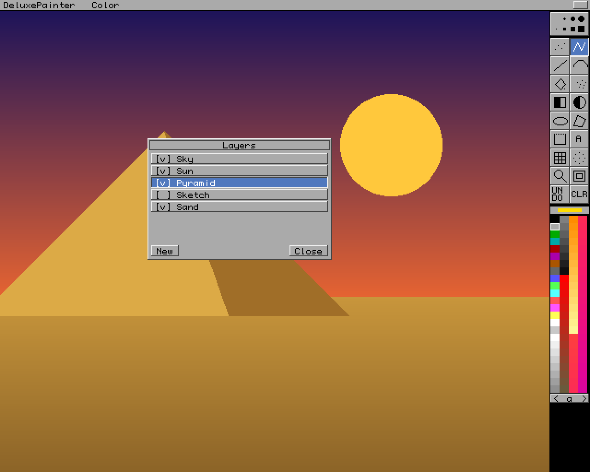
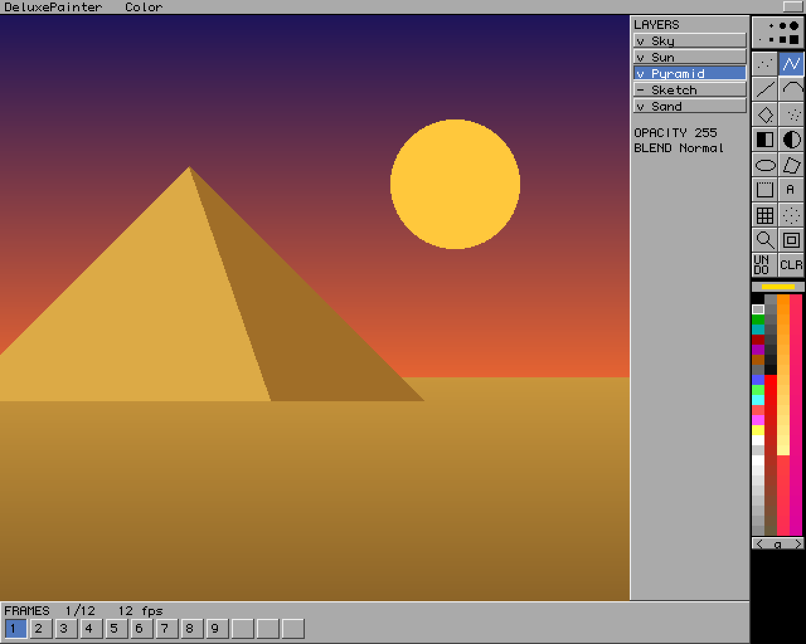
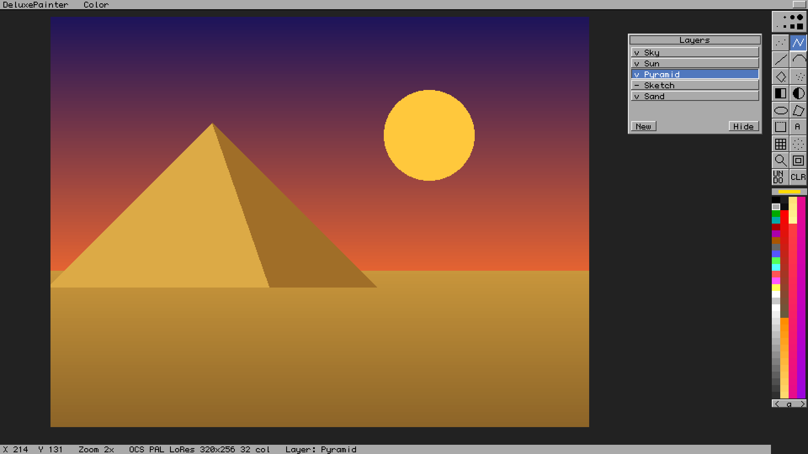

# UI layout options (design checkpoint 1)

> **Superseded in visual style** by [AMIGA_GUI_FIDELITY.md](AMIGA_GUI_FIDELITY.md): the GUI reproduces the Amiga DeluxePaint screen exactly. The sketches below only illustrate the layout decision (C = screen sized to the window, A = stock Amiga screen sizes); their widgets, font and grey work area are not the target. Real renders: [screenshots/](screenshots/).

All three keep the same DeluxePaint IV AGA visual language: one-line grey menu bar, two-column toolbox at the right, multi-column AGA palette with page selector, square bevelled requesters, original bitmap font. They differ only in how the modern additions (layers, frames, status) are integrated and how much screen space the canvas gets on large monitors.

The mockups are rough sketches drawn with a placeholder font (the real UI gets an original 8×8 pixel font) and simplified icons. Shown at 2×.

| Option | Mockup | Idea | Pros | Cons |
|---|---|---|---|---|
| **A — Classic** |  | Fixed 640×512 virtual screen exactly like the original. Layers, frames etc. open as pop-up requesters (like Palette/Fill Type in DPaint). | Most authentic; nothing on screen the original didn't have | Layer work means opening/closing a requester often; letterboxed on wide monitors |
| **B — Classic + docked panel** |  | Same 640×512 screen, but a permanent pixel side panel (layers) and a frame strip at the bottom. | Layers/frames always visible; still a fixed retro screen | Canvas area shrinks noticeably at 640×512; less authentic |
| **C — Extended work area** |  | Virtual screen grows with the window (e.g. 960×540 at 4× on a 4K display). Page sits inside a grey work area; layers etc. are movable pixel requesters; status line at the bottom. | Best use of 4K/wide screens; scrolling/zoom room around the page; authentic widgets | The overall screen proportions differ from the original |

**Decision (2026-11-09, owner): C is the default layout; A is available as a "Classic screen" preference.** Both share the same widgets. B's permanent panel is not planned; it can be revisited if layer-heavy work demands it.
